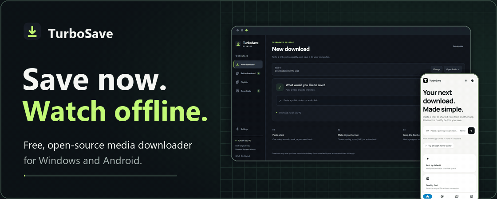

# TurboSave

<p align="center"></p>

**Save videos and audio for offline playback.** Paste a link, pick a format and quality, and save the file on your device. TurboSave is free and open source. No TurboSave account required.

**[Download for Windows](https://github.com/chanthupaa/TurboSave/releases/download/desktop-v0.8.0-beta.6/TurboSave-Desktop-0.8.0-beta.6-setup.exe)** · [Portable Windows app](https://github.com/chanthupaa/TurboSave/releases/download/desktop-v0.8.0-beta.6/TurboSave-Desktop-0.8.0-beta.6-portable.exe) · [Android source](android/) · [All releases](https://github.com/chanthupaa/TurboSave/releases)

## Get TurboSave

| Platform | Version | What’s available |
| --- | --- | --- |
| **Windows 10/11 x64** | `0.8.0-beta.6` | [Installer, portable app, matching source and SHA-256 checksums](https://github.com/chanthupaa/TurboSave/releases/tag/desktop-v0.8.0-beta.6) |
| **Android** | `1.5.3+13` | [Source and build instructions](android/README.md) · [Release readiness](android/RELEASE_READINESS.md) |

The Windows beta is unsigned. On first launch, connect to the internet so TurboSave can fetch and verify its download tools. The Android release currently offers source code only.

## What you can do

- **Windows** — Choose a save folder per download, queue multiple links, or preview a public YouTube playlist and pick the videos you want. Pause and resume supported downloads. Check for possible duplicate videos before starting the full download.
- **Android** — Share a link from another app or paste it into TurboSave. Review available formats and quality, then find your saved media in the local library.

<details>
<summary>View full-size app screenshots</summary>

**Windows**


**Android**


These previews show example data.

</details>

Available formats and qualities depend on the source. Sign-in, DRM and site restrictions can affect availability. Save only media you have permission to download. [TurboSave Web](https://github.com/chanthupaa/turbosave-web) is maintained separately.

## Build from source

```sh
git clone https://github.com/chanthupaa/TurboSave.git
cd TurboSave
```

<details>
<summary>Windows build · Node.js 24 and Electron</summary>

```powershell
cd desktop
npm ci
npm run tools:prepare
npm test
npm run build
```

See the [Windows build guide](desktop/BUILD_GUIDE.md) and [dependency source review](desktop/DEPENDENCY_SOURCES.md).

</details>

<details>
<summary>Android build · Flutter and Android SDK</summary>

```powershell
cd android
flutter pub get
flutter analyze --no-pub lib test
flutter test --no-pub
```

See the [Android build instructions](android/README.md) for the APK build and local signing setup.

</details>

## Contributing

[Report a bug](https://github.com/chanthupaa/TurboSave/issues) with the platform, version, and steps to reproduce it. Remove private links and local file paths from examples. Use [private security reporting](SECURITY.md) for vulnerabilities.

[Windows contribution guide](desktop/CONTRIBUTING.md) · [Android contribution guide](android/CONTRIBUTING.md) · [GPL-3.0-only license](LICENSE)

Third-party components keep their own licenses and notices in each platform folder.

### Acknowledgments

Thanks to everyone who contributes code, tests the apps, or reports issues. TurboSave’s maintainer used OpenAI’s ChatGPT and Codex to help develop features, debug issues, test builds, and write documentation. [ChatGPT](https://chatgpt.com/overview/) · [OpenAI Codex](https://openai.com/codex/)
